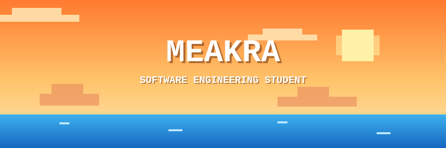
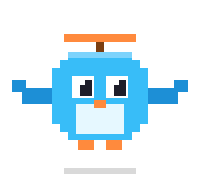

 

  

🐾 **Want Sky Puff to follow your mouse?** [Open the live version](https://kara16125-ui.github.io/mouse-puff.html)

---

## 👨‍💻 About Me

Hi! I'm **MEAKRA**, a Software Engineering student at **NTTI**, based in Phnom Penh, Cambodia 🇰🇭.

I'm passionate about software development, modern web technologies, and building applications that solve real-world problems.

- 🎓 Studying Software Engineering at NTTI
- 💻 Interested in Frontend & Full-Stack Development
- ⚛️ Currently learning React.js
- 🚀 Building projects and improving my coding skills
- 🎯 Goal: Become a Professional Software Engineer
- 🌱 Always learning something new

> 💡 "Great things are built one line of code at a time."

---

## 🛠️ Tech Stack & Tools

### 💻 Programming Languages

### 🌐 Frontend Development

### 🗄️ Database & Development Tools

---

## 🟩 Contribution Activity

---

## 🏆 GitHub Trophies

---

## 🤝 Connect With Me

### 💙 Thanks for visiting my profile!

**Keep Learning · Keep Building · Keep Growing**

